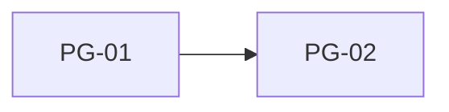

# 设计需求书（Design Brief）

> 契约说明：设计 Agent 翻译 PRD 后的产出，是驱动 Figma AI 生成的**唯一指令源**。
> 生成的设计稿必须逐页对照本文件校验；开发 Agent 不读本文件（它消费的是 03 设计三件套）。

## 元数据

| 字段 | 值 |
|------|-----|
| 项目代号 | {{project_codename}} |
| 需求书版本 | v{{version}} |
| 基于 PRD 版本 | {{prd_version}} |
| 生成日期 | {{created_at}} |
| 状态 | `draft` / `in-review` / `approved` |

## 1. 设计原则与基调

<!-- 3-5 条，指导 Figma AI 生成方向与人工确认标准 -->

- {{design_principle}}

## 2. 设计系统引用

<!-- 前置资产：团队 Figma 组件库 + Variables。生成必须在组件库约束内 -->

| 资产 | Figma 位置/Key | 说明 |
|------|---------------|------|
| 组件库 | {{library_key}} | {{description}} |
| 颜色 tokens | {{color_vars}} | 语义色：primary/surface/error… |
| 文字 tokens | {{type_vars}} | 标题/正文/说明层级 |
| 间距 tokens | {{spacing_vars}} | 4/8/12/16/24… |

## 3. 全局规范

| 项 | 规范 |
|----|------|
| 深浅色 | {{theme_mode}} |
| 基准机型 | {{base_device}}（如 iPhone 15 / 393×852） |
| 圆角/阴影 | {{radius_shadow}} |
| 图标风格 | {{icon_style}} |

## 4. 逐页设计指令

<!-- 每个页面一个区块。区块结构 = 给 Figma AI 的布局指令；元素绑定 = 数据与组件引用 -->

### PG-01 · {{page_name}}

- **入口/出口**：{{entry}} → {{exits}}
- **区块结构**（自上而下）：
  1. {{section_1}}（组件：{{component}}）
  2. {{section_2}}（组件：{{component}}）
- **元素与数据绑定**：

| 元素 | 绑定数据/动作 | 引用组件/token |
|------|-------------|---------------|
| {{element}} | {{data_or_action}} | {{component_or_token}} |

- **交互说明**：{{interactions}}
- **空态/加载态/错误态**：{{states}}

### PG-02 · {{page_name}}

<!-- 同上结构，逐页展开；PRD 页面清单中的每一页都必须有对应区块 -->

## 5. 导航流

<!-- 页面间跳转关系，供生成后校验与开发路由设计 -->

## 6. 生成与校验记录

<!-- 设计 Agent 每轮「Figma AI 生成 → MCP 读回校验」必须记录 -->

| 轮次 | Figma 生成时间 | 校验结果 | 缺陷与处理 |
|------|--------------|---------|-----------|
| 1 | {{ts}} | {{pass_fail}} | {{issues}} |

**校验清单**（每轮逐项核对）：
- [ ] 页面覆盖：PRD 页面清单全覆盖，无多无少
- [ ] 区块结构：与第 4 节逐页指令一致
- [ ] Token 合规：颜色/文字/间距均引用 tokens，无硬编码值
- [ ] 组件复用：使用了组件库组件，无游离图层堆砌
- [ ] 导航流：与第 5 节一致

### Token 覆盖自检（强制 · P0 教训）

> ⚠️ 逐页指令里出现的**每一个**设计值都必须能在第 2 节 token 表中找到。
> P0 事故：热力图格子圆角 8、空态图标灰均无 token → 开发被迫硬编码或自行派生。

| 扫描项 | 出现的值 | 对应 token | 状态 |
|--------|---------|-----------|------|
| 颜色值（`#RRGGBB`） | {{value}} | {{token}} | ✅ 有 / ❌ 缺 |
| 字号（`NNpt` / `NN sp`） | {{value}} | {{token}} | ✅ / ❌ |
| 间距 | {{value}} | {{token}} | ✅ / ❌ |
| 圆角 | {{value}} | {{token}} | ✅ / ❌ |
| 其他（阴影/描边/透明度） | {{value}} | {{token}} | ✅ / ❌ |

**结论**：缺失项数量 = {{count}}（必须为 0，否则先补 token 再生成）

### 公式化规约自检（强制 · P0 教训）

> 凡涉及网格、列表容量、循环次数、天数窗口的规约，**必须写成公式**，不得写死行列数。
> P0 事故：需求书写"7 列×5 行"，但 30 天 + 起始偏移最坏需 36 格，开发被迫偏离契约。

| 规约项 | 写法 | 检查 |
|--------|------|------|
| {{grid}} | `rows = ceil((leading + days) / 7)` | ✅ 公式 / ❌ 固定值 |

## 决策记录（Decision Log）

| 日期 | 版本 | 决策 | 理由 | 提出方 |
|------|------|------|------|--------|
| {{date}} | v1 | 初始版本 | - | 设计 Agent |

## 评审状态

| 动作 | 日期 | 意见摘要 | 影响页面 |
|------|------|---------|---------|
| 待确认 | - | - | - |

> 关卡 2 · 用户三态：✅ 通过 / 🔧 调整（改指令重新生成，仅涉及被质疑页面）/ ⏪ 打回（PRD 有误，退回规划）
