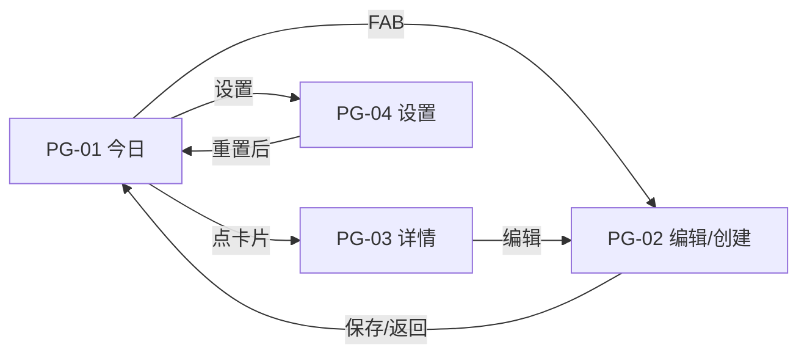

# 产品需求文档（PRD）· demo-habit 习惯打卡

## 元数据

| 字段 | 值 |
|------|-----|
| 项目代号 | demo-habit |
| PRD 版本 | v1 |
| 基于简报版本 | v1（confirmed） |
| 生成日期 | 2026-11-11 |
| 状态 | `approved` |

## 1. 产品概述

极简习惯打卡 App（Flutter，纯本地，无登录）。用户创建习惯 → 首页一键打卡今日 →
详情页查看 30 天热力图与统计（连续天数/总次数/完成率）。核心体验：**打卡一步可达，
进度一眼可见**。同时作为 AI 移动应用生产线的全流程验证载体。

## 2. 用户故事

| # | 用户故事 | 优先级 | 验收标准 |
|---|---------|--------|---------|
| US-1 | 作为用户，我想在首页对今日习惯一键打卡，以便快速记录 | P0 | 点击打卡按钮后卡片即时变为已打卡态（≤100ms 感知）；重复点击不产生重复记录；再次点击可取消当日打卡 |
| US-2 | 作为用户，我想创建习惯（名称/图标/颜色/频率），以便建立我的习惯清单 | P0 | 四要素均可设置；频率支持 每天 / 每周 N 次（N∈1-7，步进器）；名称为空或 >20 字时保存按钮禁用并提示 |
| US-3 | 作为用户，我想查看习惯的连续天数/总打卡/完成率，以便了解坚持情况 | P0 | 三项统计按第 5 节定义计算，跨天后自动正确 |
| US-4 | 作为用户，我想看某习惯近 30 天的日历热力图，以便直观回顾 | P0 | 热力图覆盖今天往前 30 个自然日；有打卡的日期高亮该习惯颜色 |
| US-5 | 作为用户，我想编辑或删除习惯 | P0 | 编辑保存后列表与详情即时更新；删除有二次确认，删除后其打卡记录一并清除 |
| US-6 | 作为用户，我的数据在重启 App 后不丢失 | P0 | 杀进程重开，习惯与打卡记录完整还原 |
| US-7 | 作为用户，我想一键清空全部数据重新开始 | P1 | 设置页重置入口，二次确认后清空并回到空态 |

## 3. 功能需求

| # | 功能 | 页面/入口 | 详细描述 | 数据需求 | 关联故事 |
|---|------|----------|---------|---------|---------|
| F-1 | 今日打卡列表 | PG-01（启动页） | 顶部显示今日日期与今日进度（已打卡数/今日应打卡数）；下方为习惯卡片列表（图标、名称、频率标签、打卡按钮）；已打卡卡片视觉置灰+对勾；列表按创建时间排序 | habits、今日 checkIns | US-1 |
| F-2 | 创建/编辑习惯 | PG-02（FAB / 详情页编辑入口） | 表单：名称输入（≤20 字）、图标选择（预设 12 枚网格单选）、颜色选择（token 色板 6 色单选）、频率（每天 / 每周 N 次步进器 1-7）；编辑态额外提供删除（二次确认） | habit 写操作 | US-2, US-5 |
| F-3 | 习惯详情统计 | PG-03（卡片点击） | 顶部习惯标识（图标+名称+颜色）；统计卡三格：连续天数 / 总打卡 / 30 天完成率；30 天热力图（7 行×~5 列日历式，今天在最右/最下）；编辑入口 | habit、其 checkIns、统计计算 | US-3, US-4 |
| F-4 | 本地持久化 | 全局 | 单 JSON 文件存储（应用文档目录），任何写操作即时落盘；启动时加载 | habits、checkIns 全量 | US-6 |
| F-5 | 设置与数据重置 | PG-04（PG-01 右上角入口） | 数据重置按钮 → 确认对话框 → 清空全部 → 返回空态首页；版本信息展示 | 全量删除 | US-7 |
| F-6 | 空态引导 | PG-01 | 无习惯时显示引导文案 + 「创建第一个习惯」按钮 → PG-02 | - | US-2 |

## 4. 页面清单与导航结构

| 页面 ID | 页面名 | 入口 | 主要元素 | 跳转关系 |
|---------|--------|------|---------|---------|
| PG-01 | 今日打卡（首页） | App 启动 | 日期+今日进度头、习惯卡片列表、空态引导、FAB(＋)、设置图标 | FAB→PG-02(创建)；卡片→PG-03；设置图标→PG-04 |
| PG-02 | 习惯编辑 | FAB / PG-03 编辑按钮 | 名称输入、图标网格、颜色行、频率选择器、保存按钮、(编辑态)删除按钮 | 保存→返回来源页；删除确认后→PG-01 |
| PG-03 | 习惯详情 | PG-01 卡片点击 | 习惯标识头、三格统计卡、30 天热力图、编辑按钮 | 编辑→PG-02(编辑态)；返回→PG-01 |
| PG-04 | 设置 | PG-01 右上角 | 数据重置项、关于（版本号） | 重置确认后→PG-01（空态） |

**导航流**：

## 5. 数据模型（概念级）

**Habit（习惯）**
- `id`: String（UUID）
- `name`: String（1-20 字）
- `iconKey`: String（预设 12 枚中的 key）
- `colorKey`: String（token 色板 6 色 key）
- `frequencyType`: enum `daily` / `weeklyN`
- `weeklyTarget`: int（仅 weeklyN，1-7）
- `createdAt`: DateTime

**CheckIn（打卡）**
- `id`: String（UUID）
- `habitId`: String（外键）
- `date`: String（`yyyy-MM-dd`，本地时区）
- `createdAt`: DateTime
- 约束：`(habitId, date)` 唯一；删除 Habit 级联删除其 CheckIn

**统计定义（v1 定案，开发与测试共同基准）**
- **今日应打卡数**（PG-01 头部）：daily 习惯计 1；weeklyN 习惯：本周已打卡次数 < weeklyTarget 时计 1，否则计 0
- **连续天数（streak）**：
  - daily：从昨天往回连续打卡的天数；今天已打卡则从今天起算。中断（存在应打卡日未打卡）即清零（简报已澄清）
  - weeklyN：**连续周数**——上周及更早每周打卡次数 ≥ N 则累加；本周次数计入判断（本周未满不影响既有周数）
- **总打卡**：该习惯 CheckIn 总条数
- **30 天完成率** = 近 30 个自然日 CheckIn 次数 ÷ 应打卡次数（四舍五入取整百分比）。daily 应打卡=30；weeklyN 应打卡 = `round(30 / 7 × N)`，结果下限 1

## 6. 非功能需求

| 类别 | 要求 |
|------|------|
| 性能 | 冷启动到首页可交互 < 2s；打卡响应即时（本地写 < 50ms）；列表滚动 60fps |
| 兼容性 | iOS 13+（iPhone 模拟器验证）；Flutter stable |
| 数据安全 | 仅本地存储；无网络权限需求 |
| 代码质量 | `flutter analyze` 零告警；遵循 AGENTS.md 规范体系；Riverpod 状态管理 |

## 7. 明确不做

（继承简报第 4 节）账户/云同步、推送提醒、补签、社交、多语言、深色模式（token 架构预留）。
规划阶段无新增排除项。

## 8. 任务拆解（开发执行清单）

| # | 任务 | 前置依赖 | 验收方式 | 状态 |
|---|------|---------|---------|------|
| T-01 | 工程初始化：flutter create、目录结构、AGENTS.md 就位、依赖（riverpod/json_serializable/path_provider/uuid）、lint 配置 | 无 | `flutter analyze` 通过、空壳 App 模拟器可跑 | ☐ |
| T-02 | 数据模型：Habit/CheckIn 模型 + json_serializable + 枚举兜底 | T-01 | round-trip 单测通过 | ☐ |
| T-03 | 本地存储：JSON 文件仓库（读/写/落盘时机） | T-02 | 持久化 round-trip 单测、重启还原 | ☐ |
| T-04 | 统计服务：streak/total/completionRate/今日进度 纯函数 | T-02 | 单测覆盖 daily/weeklyN、跨天、中断清零、边界 | ☐ |
| T-05 | 状态管理：habits provider、今日视图、打卡/取消、CRUD 动作 | T-03 | provider 单测：打卡唯一性、级联删除 | ☐ |
| T-06 | PG-01 今日打卡页（含空态、打卡交互、进度头） | T-05 | widget 测试：打卡态切换、空态展示 | ☐ |
| T-07 | PG-02 习惯编辑页（创建/编辑/删除、表单校验） | T-05 | widget 测试：必填校验、N∈1-7 边界 | ☐ |
| T-08 | PG-03 习惯详情页（统计卡+30 天热力图） | T-04, T-05 | widget 测试：统计数据渲染、热力图 30 格 | ☐ |
| T-09 | PG-04 设置页 + 重置二次确认 | T-03 | widget 测试：重置后空态 | ☐ |
| T-10 | 主题接入：设计 tokens → app_theme.dart（值来自设计交付物 v1） | 设计阶段完成 | 无硬编码颜色/字号/间距（grep 自查） | ☐ |
| T-11 | 集成自测：全路径手工冒烟（模拟器）+ analyze/test 全绿 | T-06~T-10 | 自测报告完成 | ☐ |

## 9. 测试要点

| # | 测试要点 | 类型 | 关联功能 |
|---|---------|------|---------|
| TS-01 | 同一习惯同一天重复打卡 → 仅一条记录；取消→恢复未打卡态 | 功能 | F-1, US-1 |
| TS-02 | 跨天场景：今天未打卡不影响 streak（从昨天回溯） | 边界 | 统计, US-3 |
| TS-03 | streak 中断清零：daily 漏打一天后重新累计 | 边界 | 统计, US-3 |
| TS-04 | weeklyN streak：按周计数，本周不满不影响历史周数 | 边界 | 统计, US-3 |
| TS-05 | weeklyN N=7 等效每天语义；N=1 下限 | 边界 | F-2, US-2 |
| TS-06 | 名称空/21 字校验；保存禁用态 | 边界 | F-2, US-2 |
| TS-07 | 删除习惯 → 级联删除打卡记录，统计与热力图不再引用 | 功能 | F-2, US-5 |
| TS-08 | 持久化 round-trip：写入→重进程读取一致（含枚举兜底） | 功能 | F-4, US-6 |
| TS-09 | 重置：确认后 habits/checkIns 清空、文件为空态、首页空态 | 功能 | F-5, US-7 |
| TS-10 | 热力图 30 天边界：恰含今天；无打卡习惯全灰 | 边界 | F-3, US-4 |
| TS-11 | 完成率取整：round(30/7×N) 分母边界（N=1,4,7） | 边界 | 统计, US-3 |
| TS-12 | UI 快照对比：4 页 vs 设计稿 golden master | UI | 全部页面 |

## 决策记录（Decision Log）

| 日期 | 版本 | 决策 | 理由 | 提出方 |
|------|------|------|------|--------|
| 2026-11-11 | v1 | weeklyN 的 streak 按「连续周数」而非天数定义 | 天数语义对每周型习惯无意义；周数是最自然的坚持度量 | 规划 Agent |
| 2026-11-11 | v1 | 完成率分母统一公式（daily=30；weeklyN=round(30/7×N)） | 避免「应打卡日」歧义；公式确定后方可测 | 规划 Agent |
| 2026-11-11 | v1 | 今天未打卡不打断 streak（从昨天回溯） | 避免上午打开 App 全部显示 0 的挫败感，符合品类惯例 | 规划 Agent |
| 2026-11-11 | v1 | 删除为物理删除并级联打卡记录 | MVP 无回收站需求，模型最简 | 规划 Agent |
| 2026-11-11 | v1 | 打卡可取消（再次点击） | 误触兜底；不加则用户无恢复手段 | 规划 Agent |

## 评审状态

| 动作 | 日期 | 意见摘要 | 影响范围 |
|------|------|---------|---------|
| ✅ 通过 | 2026-11-11 | 用户确认 5 项统计口径决策；解锁设计阶段 | - |

> **关卡 1** · ✅ 通过（解锁设计）/ 🔧 调整（指出质疑点，增量修订）/ ⏪ 打回（退回简报）
