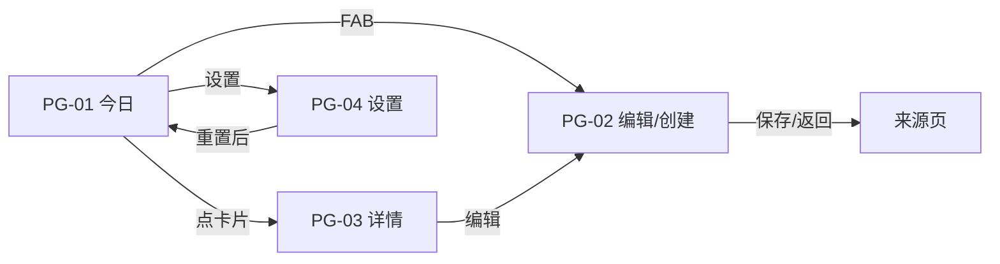

# 设计需求书（Design Brief）· demo-habit 习惯打卡

## 元数据

| 字段 | 值 |
|------|-----|
| 项目代号 | demo-habit |
| 需求书版本 | v1 |
| 基于 PRD 版本 | v1（approved） |
| 生成日期 | 2026-11-11 |
| 状态 | `approved` |

## 1. 设计原则与基调

- **一步打卡**：打卡按钮是全 App 视觉权重最高的元素，首页无需进入详情即可完成打卡
- **干净留白**：卡片间距充分，单屏 ≤ 4 张卡片不显拥挤；无装饰性元素
- **色彩有情绪但克制**：习惯颜色只出现在「属于该习惯」的元素上（图标底、按钮、热力图），全局界面保持中性灰白
- **数据一眼可读**：统计数字大字号突出，标签小字辅助；热力图色彩深浅即信息
- **圆角亲和**：全部容器圆角化（卡 16 / 按钮 12 / 输入框 12），无直角生硬感

## 2. 设计系统引用

> P0 现实约束：团队级 Figma 组件库尚未建立。本 demo 采用**项目内自建轻量 token 集**，
> 由本需求书第 2.1-2.3 节定义唯一权威值；Figma 侧按此值生成并在 Variables 中落库，
> 开发侧映射为 `app_theme.dart`。（此为流水线决策，已记入决策记录）

### 2.1 颜色 tokens

| Token | 值 | 用途 |
|-------|-----|------|
| `color.primary` | `#4F6BED` | 主操作色（打卡按钮默认、主按钮、选中态） |
| `color.surface` | `#FFFFFF` | 卡片/页面底 |
| `color.background` | `#F6F7FB` | 页面背景（surface 之外的底层） |
| `color.textPrimary` | `#1A1D29` | 主文字 |
| `color.textSecondary` | `#8A90A3` | 次要文字/标签 |
| `color.divider` | `#ECEDF3` | 分隔线/描边 |
| `color.error` | `#E5484D` | 删除/危险操作 |
| `color.success` | `#30A46C` | 已打卡对勾辅助色 |
| `color.habit.blue` | `#4F6BED` | 习惯色板① |
| `color.habit.green` | `#30A46C` | 习惯色板② |
| `color.habit.orange` | `#F76B15` | 习惯色板③ |
| `color.habit.purple` | `#8E4EC6` | 习惯色板④ |
| `color.habit.pink` | `#D6409F` | 习惯色板⑤ |
| `color.habit.teal` | `#12A594` | 习惯色板⑥ |

> 习惯色 20% 不透明度版本（`withValues(alpha: 0.2)`）用作图标底色，不单独建 token。

### 2.2 文字 tokens

| Token | 值 | 用途 |
|-------|-----|------|
| `type.display` | 28 / w700 / -0.5 字距 | 首页日期、统计大数字 |
| `type.titleLarge` | 20 / w600 | 页面标题、习惯名（详情页） |
| `type.titleMedium` | 16 / w600 | 卡片内习惯名、区块标题 |
| `type.body` | 14 / w400 | 正文、表单输入 |
| `type.label` | 12 / w500 | 频率标签、计数器、辅助说明 |

（单位 sp；行高默认 1.4 倍）

### 2.3 间距与形状 tokens

| Token | 值 |
|-------|-----|
| `spacing.xs` | 4 |
| `spacing.s` | 8 |
| `spacing.m` | 16 |
| `spacing.l` | 24 |
| `radius.card` | 16 |
| `radius.button` | 12 |
| `radius.input` | 12 |
| `radius.chip` | 999（全圆角） |

## 3. 全局规范

| 项 | 规范 |
|----|------|
| 深浅色 | 仅浅色 |
| 基准机型 | iPhone 15（393×852） |
| 圆角/阴影 | 卡片：radius 16 + 阴影 `0 2 8 rgba(26,29,41,0.04)`；无其他阴影 |
| 图标风格 | 单色线性图标（SF Symbols 类），习惯图标可用彩色填充圆形底 |
| 触控热区 | ≥ 44×44pt |
| 页面边距 | 左右 `spacing.m`(16) |

## 4. 逐页设计指令

### PG-01 · 今日打卡（首页）

- **入口/出口**：App 启动 → FAB 进 PG-02、点卡片进 PG-03、右上设置进 PG-04
- **区块结构**（自上而下）：
  1. **头部**（背景 `background`，无边距卡）：大字日期「11月11日 星期二」（`display`）+ 右上角设置图标（24pt，`textSecondary`）；下行今日进度 chip（全圆角，`primary` 10% 底 + `primary` 文字）：「今日 2/4」
  2. **习惯卡片列表**（垂直，间距 `s`=8，页边距 `m`=16）：每张卡片结构见下
  3. **FAB**（右下 16/24 边距，56pt 圆角 16，`primary` 底白「＋」）
- **习惯卡片内部结构**（高 ~72pt，`surface` 底，radius 16）：
  1. 图标：40pt 圆形，底 = 习惯色 20%，符号 = 所选图标（习惯色）
  2. 名称（`titleMedium`）+ 频率标签（`label`，`textSecondary`，如「每天」/「每周 3 次」）
  3. 打卡按钮：44pt 圆形；未打卡 = 习惯色描边 2pt + 习惯色对勾图标；已打卡 = 习惯色填充 + 白对勾，且卡片整体透明度 55% 置灰
- **元素与数据绑定**：

| 元素 | 绑定数据/动作 | 引用组件/token |
|------|-------------|---------------|
| 日期文本 | 当前日期（周几本地化） | `type.display` `textPrimary` |
| 进度 chip | 今日已打卡/应打卡 | `primary` 10% 底 |
| 卡片 | Habit 列表（创建时间序） | `surface` `radius.card` |
| 打卡按钮 | 点击打卡/再点取消 | 习惯色 / `success` |
| FAB | → PG-02（创建态） | `color.primary` |

- **交互说明**：打卡按钮点击即时切换（无跳转，可加 ≤200ms 缩放微动效）；卡片点击（按钮以外区域）→ PG-03
- **空态/加载态/错误态**：
  - 空态：居中 96pt 灰色线性图标（日历对勾）+「还没有习惯」（`titleMedium`）+「创建第一个习惯开始打卡吧」（`body` `textSecondary`）+ 主按钮「＋ 创建习惯」
  - 加载态：3 张骨架卡片（`divider` 底圆角块）
  - 错误态（存储读取失败）：居中「数据加载失败」+ 重试按钮

### PG-02 · 习惯编辑（创建/编辑）

- **入口/出口**：PG-01 FAB（创建态）/ PG-03 编辑按钮（编辑态）→ 保存返回来源页
- **区块结构**（自上而下，表单间距 `m`=16）：
  1. **导航栏**：返回箭头 + 标题「新建习惯」/「编辑习惯」（`titleLarge`）+ 右侧「保存」文字按钮（`primary`，名称非法时禁用置灰）
  2. **名称输入**：单行输入框（`radius.input`，`divider` 描边，焦点 `primary` 描边），右下角计数 `x/20`（`label`）
  3. **图标选择**：区块标题「图标」（`titleMedium`）+ 12 枚图标网格（4 列×3 行，每格 48pt，圆角 12；选中格 = `primary` 10% 底 + `primary` 图标，未选中 = `divider` 底 + `textSecondary` 图标）
  4. **颜色选择**：区块标题「颜色」+ 6 色圆点行（24pt 圆，间距 `s`；选中加 2pt 外圈描边偏移 2）
  5. **频率卡**（`surface` 圆角 16）：两个选项行——「每天」radio；「每周 N 次」radio + 选中时右侧步进器（− N ＋，N∈1-7，到边界时对应按钮禁用）
  6. **（仅编辑态）删除按钮**：底部居中红色文字「删除习惯」（`error`）
- **元素与数据绑定**：

| 元素 | 绑定数据/动作 | 引用组件/token |
|------|-------------|---------------|
| 名称输入 | Habit.name，1-20 字校验 | `radius.input` |
| 图标网格 | Habit.iconKey（12 选 1） | `primary` 选中态 |
| 色点行 | Habit.colorKey（6 选 1） | 习惯色板 |
| 频率 radio | Habit.frequencyType | `primary` |
| 步进器 | Habit.weeklyTarget 1-7 | `primary`/`divider` |
| 删除 | 确认对话框→删除并级联 | `color.error` |

- **交互说明**：名称为空或 >20 字 → 保存禁用 + 输入框 `error` 描边 + 底部「名称需为 1-20 个字」（`label` `error`）；删除弹确认对话框（标题「删除习惯？」正文「将同时删除其全部打卡记录，不可恢复」取消/删除）
- **空态/加载态/错误态**：表单页无空/加载态；校验错误态如上

### PG-03 · 习惯详情

- **入口/出口**：PG-01 卡片 → 返回 PG-01；导航栏编辑 → PG-02 编辑态
- **区块结构**（自上而下，间距 `m`）：
  1. **导航栏**：返回箭头 + 标题「习惯详情」（`titleLarge`）+ 右侧编辑图标
  2. **习惯头**：64pt 圆形图标（习惯色 20% 底）+ 习惯名（`titleLarge`）+ 频率标签（`label` `textSecondary`）
  3. **统计三格卡**（`surface` 圆角 16，三等分竖分隔线）：每格 = 大数字（`display`）+ 标签（`label` `textSecondary`）——「🔥 连续天数」「总打卡」「30天完成率%」
  4. **热力图卡**（`surface` 圆角 16）：标题「近 30 天」（`titleMedium`）+ 日历式网格（7 列×5 行内，列=周几，从最早日在左上、今天右下），每格 32pt 圆角 8：无打卡 = `divider` 底，有打卡 = 习惯色底（当月内的格子带日期角标数字 `label`）
- **元素与数据绑定**：

| 元素 | 绑定数据/动作 | 引用组件/token |
|------|-------------|---------------|
| 统计数字 | streak / total / rate（PRD 第 5 节口径） | `type.display` |
| 热力图格子 | 近 30 自然日 CheckIn | 习惯色 / `divider` |
| 编辑图标 | → PG-02 | - |

- **交互说明**：格子无点击交互（P0 只读回顾）
- **空态/加载态/错误态**：新习惯无打卡 → 统计显示 0/0/0%，热力图全灰，卡下方引导文案「完成第一次打卡吧 👇」（`body` `textSecondary` 居中）

### PG-04 · 设置

- **入口/出口**：PG-01 右上设置 → 返回 PG-01
- **区块结构**：
  1. **导航栏**：返回 + 「设置」（`titleLarge`）
  2. **数据分组卡**（`surface` 圆角 16）：单行「重置所有数据」（`body` `error`）+ 右侧警示图标
  3. **关于分组卡**：「版本 1.0.0」（`body` `textSecondary`）
- **元素与数据绑定**：

| 元素 | 绑定数据/动作 | 引用组件/token |
|------|-------------|---------------|
| 重置行 | 确认对话框→清空→pop 至 PG-01 空态 | `color.error` |
| 版本行 | 静态 | `textSecondary` |

- **交互说明**：重置确认对话框：标题「重置所有数据？」正文「将删除全部习惯与打卡记录，此操作不可恢复」取消（默认）/「重置」（`error` 底白字）
- **空态/加载态/错误态**：无

## 5. 导航流

## 6. 生成与校验记录

| 轮次 | Figma 生成时间 | 校验结果 | 缺陷与处理 |
|------|--------------|---------|-----------|
| 1 | 待执行（见下方 P0 协作说明） | - | - |

**校验清单**（每轮逐项核对）：
- [ ] 页面覆盖：PRD 页面清单（PG-01~04）全覆盖，无多无少
- [ ] 区块结构：与第 4 节逐页指令一致
- [ ] Token 合规：颜色/文字/间距均引用第 2 节 token 值，无硬编码偏差
- [ ] 组件复用：卡片/按钮/输入框样式跨页一致
- [ ] 导航流：与第 5 节一致

## 决策记录（Decision Log）

| 日期 | 版本 | 决策 | 理由 | 提出方 |
|------|------|------|------|--------|
| 2026-11-11 | v1 | P0 采用项目内自建轻量 token 集（14 色 + 5 字级 + 间距/圆角），不等待团队组件库 | 团队设计系统为后续资产；demo 先以契约值保证一致性，Figma Variables 与 app_theme.dart 均以此为准 | 设计 Agent |
| 2026-11-11 | v1 | 习惯色统一 6 色板，图标 12 枚预设 | 约束 Figma AI 生成范围；避免开发侧自由发挥导致测试矩阵爆炸 | 设计 Agent |
| 2026-11-11 | v1 | 打卡按钮用「习惯色」而非全局 primary | 多习惯时视觉归属更清晰；与热力图色彩语言一致 | 设计 Agent |

## 评审状态

| 动作 | 日期 | 意见摘要 | 影响页面 |
|------|------|---------|---------|
| ✅ 通过 | 2026-11-12 | 用户确认设计原则与 token 集；随关卡 2 一并通过 | - |
